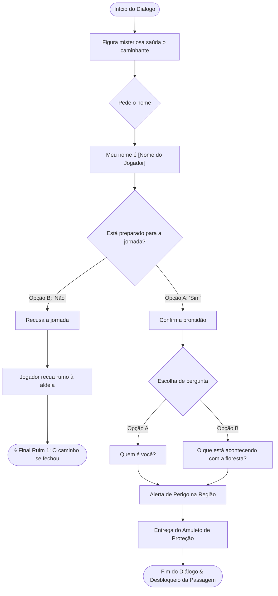

## 📍 Contexto da Cena
Primeiro contato do jogador com o Pajé Andarilho. Esta cena introduz o mistério da floresta, apresenta os perigos que habitam a região, ensina sobre o perigo das miragens e concede o item-chave de proteção inicial.

---

## 🗺️ Fluxograma do Diálogo



---

## 💬 Roteiro do Diálogo

### [Nó 01] Boas-vindas e Identificação
> **??? (Figura Misteriosa):**  
> *"Ah... as águas me avisaram que um novo caminhante despertaria hoje. A floresta está inquieta, jovem. O equilíbrio foi quebrado, e os antigos espíritos caminham com raiva."*  
>  
> *"Qual seria teu nome, caminhante?"*

* **Opção de Resposta:**
  * **[A]:** *"Meu nome é [Nome do Jogador]."*

---

### [Nó 02] Teste de Prontidão
> **??? (Figura Misteriosa):**  
> *"[Nome do Jogador]... Um nome forte. Mas me diga... estaria preparado para a jornada?"*

* **Opções de Resposta:**
  * **[A] (Seguir em frente):** *"Sim."*
    * **???:** *"Assim espero."*  
      *(Transiciona para o **[Nó 03]**)*
  * **[B] (Desistir):** *"Não."*
    * **???:** *"Sem problemas. Retorne por onde veio, e achará a saída para sua aldeia."*  
      *(Ativa a condição de **Final Ruim 1** se o jogador recuar)*

> [!CAUTION] 🌿 Condição de Desfecho: Final Ruim 1
> Se o jogador escolheu **[B]** e retornar em direção à aldeia inicial:
> 1. Executar fade out para tela preta.
> 2. Exibir mensagens em sequência:
>    * **Mensagem 1:** *"As águas reclamaram sua escolha. O caminho se fechou."*
>    * **Mensagem 2:** *"Final Ruim 1 de [total_de_finais]."*
> 3. Disparar **Fim de Jogo** (Retorno ao menu principal).

---

### [Nó 03] Investigação da Floresta (Revelação da Identidade)
*(Disponível após responder 'Sim' no Nó 02. A partir daqui, a caixa de diálogo atualiza o nome do orador para **Pajé Andarilho**)*

* **Opções de Resposta:**
  * **[Opção A]:** *"Quem é você?"*
    * **Pajé Andarilho:** *"Apenas um velho pajé que escuta o vento. Mas o que importa agora não sou eu, e sim o caminho que está à sua frente."*
  * **[Opção B]:** *"O que está acontecendo com a floresta?"*
    * **??? (Figura Misteriosa):** *"A natureza reflete as feridas causadas pelos homens. E agora, essas feridas estão ganhando forma."*

---

### [Nó 04] Alerta sobre as Ameaças da Região
> [!NOTE] Estruturação das Rotas
> *(Espaço reservado para a definição das rotas/ameaças sem dependência de gênero)*

* **Opção de Rota / Alerta:**
  > **Pajé Andarilho:**  
  > *"Tenha cuidado ao se aproximar dos rios e ao cruzar as aldeias. As águas e as sombras escondem espíritos que usam ilusões para atrair os incautos."*

---

### [Nó 05] Concessão do Amuleto e Despedida
> **Pajé Andarilho:**  
> *"Eles usam ilusões para confundir a mente. Leve isso com você. Os anciões me ensinaram a trançar este amuleto... ele vai te ajudar a ver o que é real quando a tela da sua mente se distorcer."*

> [!TIP] Conquista de Saber
> Item obtido: `[[Item_Amuleto_Protecao]]` (adicionado aos saberes adquiridos).

---

## 💻 Eventos para a Engine

Ao concluir o diálogo no **[Nó 05]**, disparar os seguintes eventos:

```javascript
// 1. Registro de Saber / Inventário
if (!gameState.saberes_adquiridos.includes("amuleto_protecao")) {
    gameState.saberes_adquiridos.push("amuleto_protecao");
}

// 2. Manipulação de Cenário
WorldManager.desativar_colisor("bloqueio_passagem_aldeia_01");

// 3. Gerenciamento do NPC
NPCManager.ocultar("Paje_Andarilho"); // Retorna apenas no Encontro 02
```

### Checklist Técnico:
- [ ] Adicionar `"amuleto_protecao"` ao array `gameState.saberes_adquiridos`.
- [ ] Liberar a passagem (desativar colisor) que dá acesso à primeira aldeia.
- [ ] Ocultar o NPC da cena e persistir que o Encontro 1 foi finalizado.
- [ ] Configurar gatilho do Final Ruim 1 se o jogador recuar após responder "Não".