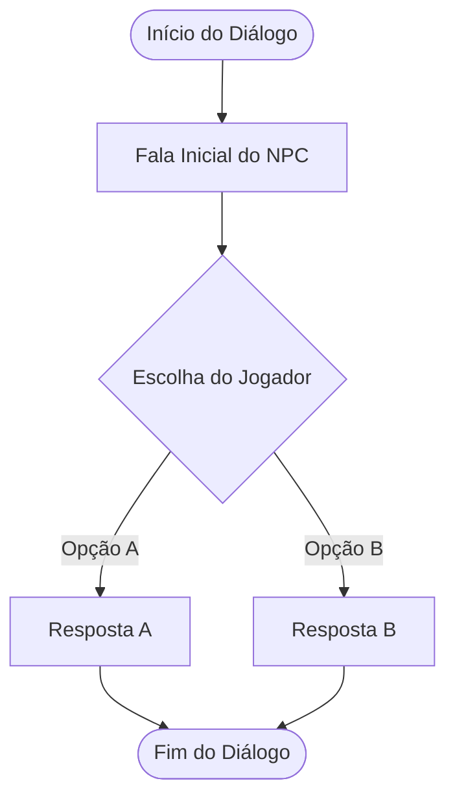

## 📍 Contexto da Cena
[Descrever o objetivo narrativo do diálogo, o estado emocional do NPC e o momento da jornada em que isso ocorre]

---

## 🗺️ Fluxograma do Diálogo



---

## 💬 Roteiro do Diálogo

### [Nó 01] Abertura
> **[Nome do NPC]:**  
> *"Texto da fala do NPC aqui..."*

* **Opções de Resposta:**
  * **[A]:** *"Opção de fala do jogador A"*
    * **[Nome do NPC]:** *"Reação à opção A"*
  * **[B]:** *"Opção de fala do jogador B"*
    * **[Nome do NPC]:** *"Reação à opção B"*

---

### [Nó 02] Continuação ou Ramificação
> **[Nome do NPC]:**  
> *"Texto seguinte..."*

---

## 💻 Eventos para a Engine

```javascript
// Exemplo de chamadas executadas ao término do diálogo:
// 1. Atualizar inventário ou saber
// gameState.saberes_adquiridos.push("saber_exemplo");

// 2. Modificar cena / colisores
// WorldManager.desativar_colisor("bloqueio_exemplo");
```

### Checklist Técnico:
- [ ] Conectar triggers de início e fim no sistema de diálogo.
- [ ] Atualizar flags necessárias no `gameState`.
